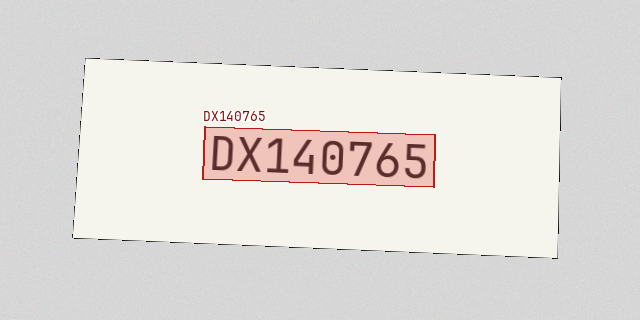
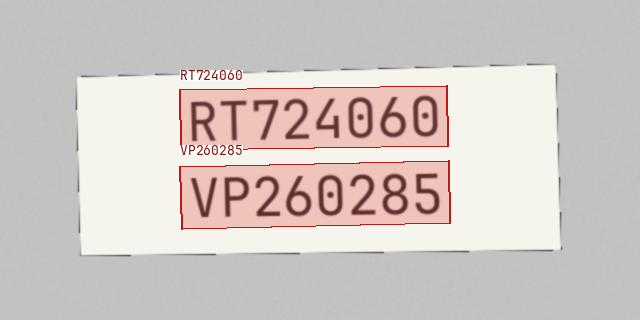

# marking-ocr

Read printed serial numbers with local ONNX models. The command accepts images or
a manifest, writes one CSV row per image, and can save detected regions, crops and
overlays. Catalog lookup and acceptance thresholds are separate from recognition.

The serial format is two uppercase Latin letters followed by six digits, such as
`AB001234`. The repository includes detector and recognizer weights, five example
images, a small catalog, and a reproducible synthetic evaluation generator.

## Install

Python 3.11 or 3.12:

```bash
uv sync --frozen --extra test
source .venv/bin/activate
marking-ocr --help
```

Or use pip:

```bash
python3.11 -m venv .venv
source .venv/bin/activate
python -m pip install -e '.[test]'
```

`python -m marking_ocr` is equivalent to `marking-ocr`. Inference runs on CPU.
The packaged models and fonts are local; prediction does not download weights.
The lockfile pins the tested dependency set. PyTorch is not required.

## Predict

```bash
marking-ocr predict --input examples/images/label.png --output runs/label.csv

marking-ocr predict --input examples/manifest.csv --output runs/examples.csv \
  --catalog examples/catalog.csv --min-score 0.95

marking-ocr predict --input examples/images/label.png --output runs/overlay.csv \
  --artifacts-dir runs/regions --overlay-alpha 0.25
```

Stdout contains short English `name: value` lines. Progress and errors go to
stderr. The CSV contains every selected input, including image failures and rows
skipped by `--fail-fast`.

The format decoder is enabled by default. It preserves the raw OCR text and
resolves `0` as `O` only in the two-letter prefix of an eight-character candidate
whose remaining six characters are digits:

```text
raw_text: J0054740
text: JO054740
format_decoded: True
```

Use `--decoder raw` to disable this rule. There are no suffix substitutions,
nearest-catalog corrections or ground-truth lookups. Two candidates that satisfy
the serial format remain ambiguous; the program does not select one by score.

| Option | Meaning |
| --- | --- |
| `--input PATH` | Required PNG/JPEG, recursive image directory, CSV or JSONL manifest. |
| `--output PATH` | Required output CSV. Parent directories are created. |
| `--split NAME` | Exact manifest split to process; omitted means all rows. |
| `--model PATH` | Model profile JSON; defaults to the bundled English recognition profile. Referenced weight paths are relative to this file. |
| `--device cpu` | ONNX Runtime CPU execution; default and currently supported device. |
| `--threads N` | Positive ONNX Runtime/OpenCV CPU thread count; default `4`. |
| `--decoder serial\|raw` | Format-assisted serial selection or unmodified OCR selection; default `serial`. |
| `--catalog PATH` | Optional CSV for exact lookup. It is never passed to the recognizer. |
| `--policy PATH` | Calibrated policy bound to the model, decoder and catalog checksums. |
| `--min-score FLOAT` | Manual threshold in `[0,1]`, mutually exclusive with `--policy`. |
| `--artifacts-dir DIR` | New or empty directory for original images, overlays, per-region crops and result JSON. Omit for CSV only. |
| `--overlay-alpha FLOAT` | Red region-fill opacity in `[0,1]`; default `0.25`. Borders and raw text labels stay visible. |
| `--limit N` | Process at most N selected rows; recorded in benchmark metadata. |
| `--overwrite` | Replace CSV/JSON outputs. Input images, manifests, models, policies and catalogs are protected. Artifact directories must remain empty. |
| `--fail-fast` | Stop inference after an image failure; still write skipped rows with explicit errors. |
| `--quiet` | Suppress progress on stderr; retain the final summary. |
| `--help` | Full command help; available on every subcommand. |

Without `--policy` or `--min-score`, recognition still runs and writes text, but
the decision is `review` with reason `uncalibrated`. A manual score threshold is a
user-selected rule, not a measured guarantee. Scores are recognizer scores, not
probabilities that a serial is correct.

## Input and output

Manifest paths are relative to the manifest file, not the working directory.
`path` is accepted as an alias for `image`. Example CSV:

```csv
sample_id,image,split,expected_text,readable,scenario,eligible
label-1,images/label.png,test,AB001234,true,active,true
blank-1,images/blank.png,test,,false,blank,false
```

Only `image` is required for prediction. A missing `sample_id` is derived from the
image path. Selected IDs and resolved image paths must be unique. Benchmarking
requires `expected_text`; empty labels are excluded from text accuracy unless
`readable=true` explicitly marks the empty string as the target. `scenario` groups
the report. `eligible` is required for calibration and marks whether a correctly
recognized image is allowed to be accepted.

Catalog CSV:

```csv
serial,item_code,name,batch,status
AB001234,M-0042,Control module,B-01,active
CD000007,M-0043,Control module,B-02,blocked
```

Required columns are `serial`, `item_code` and `status`; `name` and `batch` are
optional. Serial keys must be unique and match the format. Status is `active` or
`blocked`. Unknown and blocked entries require review.

| Output columns | Meaning |
| --- | --- |
| `sample_id,image,split` | Input identity and supplied image path. |
| `status,error` | `ok`, `error` or `skipped`, with an explicit error when processing fails. |
| `raw_text` | Text selected from the untouched OCR candidates, without the format decoder. |
| `selected_raw_text` | Original text of the candidate selected after format decoding. It can differ from `raw_text` when selection changes. |
| `text,format_decoded` | Final selected text and whether the selected candidate's prefix was changed. |
| `score,candidate_count` | Original recognizer score for the selected candidate and the number of detected text regions. |
| `format_valid,catalog_status,item_code` | Format check, exact catalog result and catalog-sourced item code. |
| `decision,reason` | `accept` or `review` under the requested policy, with the reason. |
| `expected_text,text_correct` | Optional evaluation fields; never used by the OCR engine. |
| `inference_ms,total_ms` | Detector/recognizer time, and per-image time including decoding, hashing, lookup and optional artifacts. CSV writing and model startup are outside per-image timing. |
| `input_sha256,model_id` | Input checksum and model profile identity. |
| `artifact_dir,candidates_json` | Optional artifact location; complete raw text/score/polygon candidates as JSON inside the CSV cell. |

JPEG/PNG inputs are converted to RGB with EXIF orientation applied. Limits are
20 MiB, 20 megapixels and a minimum size of 16×16. Images are processed one at a
time; only scalar results and candidate metadata accumulate for the summary.

Exit codes: `0` success, `1` model/runtime failure, `2` input/argument validation,
`3` image failures and `130` interruption. Failed readable images count as incorrect
and as empty predictions for character error rate. An incomplete run is never
reported as a complete evaluation.

## Benchmark and calibration

```bash
marking-ocr dataset --output data/synthetic-v2 --seed 20261109

marking-ocr calibrate --input data/synthetic-v2/calibration.csv --split calibration \
  --catalog data/synthetic-v2/catalog.csv --output runs/policy.json \
  --max-error 0.01 --min-accepted 30 --threads 4

marking-ocr benchmark --input data/synthetic-v2/test_clean.csv --split test_clean \
  --catalog data/synthetic-v2/catalog.csv --policy runs/policy.json \
  --output runs/test-clean.csv --metrics runs/test-clean.json --threads 4
```

Repeat the last command for `test_degraded` and `test_negative`, using new output
names. The generator refuses an existing output directory. Its other option is
`--seed`; the default is `20261109`. It writes PNG images, four split CSVs, an
all-input CSV, the catalog, detailed recipes/polygons and checksums.

`benchmark` accepts prediction options and adds `--metrics PATH` (default:
`OUTPUT.metrics.json`) and `--warmup N` (default: three successful inference calls).
Model startup and warmup are reported separately. Timings use batch size one.
The JSON records CPU, thread count, affinity, Python, package versions, peak process
RSS, model/catalog/input hashes and per-scenario counts.

`calibrate` accepts the common input/model/runtime/decoder options. Its `--output`
is a new policy JSON; `--predictions PATH` optionally overrides the default
`OUTPUT.predictions.csv`. `--max-error` bounds observed accepted errors and
`--min-accepted` sets the minimum accepted count. Calibration selects the threshold
with the highest coverage satisfying those bounds. If no threshold qualifies,
the saved policy is `review_only`. Duplicate calibration image contents and
calibration/test image overlap are rejected. Test data does not select thresholds.

## Measured results

Measured on AMD Ryzen 7 5800X, CPU, four threads, Python 3.11.16.
Each image is processed once after three warmup calls. The model and decoder were
fixed before these tests; the policy used 400 separate calibration images.

| Measure | Clean serials | Degraded serials | Negative cases |
| --- | ---: | ---: | ---: |
| Inputs / readable labels | 400 / 400 | 400 / 400 | 200 / 90 |
| Raw OCR exact | 377/400 (94.25%) | 385/400 (96.25%) | 87/90 (96.67%) |
| Format-assisted exact | 400/400 (100.00%) | 400/400 (100.00%) | 83/90 (92.22%) |
| Character error rate, final text | 0.000% | 0.000% | 0.772% |
| Accepted / wrong accepted | 320 / 0 | 317 / 0 | 0 / 0 |
| Inference p50 / p95 | 167.1 / 190.4 ms | 171.2 / 198.4 ms | 169.2 / 182.7 ms |
| Peak process RSS | 363.1 MiB | 362.3 MiB | 779.6 MiB |

All 800 valid serials were correct after format decoding; raw OCR was correct on
762/800 (95.25%). Across all 890 readable labels, final text was correct on 883
(99.21%). Four malformed labels were made less faithful by prefix decoding; all
200 negative inputs still required review under the catalog-bound policy.
The 110 negative cases marked unreadable are excluded from text accuracy and
retained in policy counts. There were no processing failures.

Calibration selected score threshold `0.94701`: 280/400 accepted, zero observed
accepted errors. On the three test splits together, 637 inputs were accepted,
with zero observed wrong acceptances. These counts describe this protocol.

Full rows and environments: [`clean`](reports/test-clean-v2/metrics.json),
[`degraded`](reports/test-degraded-v2/metrics.json),
[`negative`](reports/test-negative-v2/metrics.json),
[`summary`](reports/summary.json). Raw and final text remain separate in every CSV.

The v2 protocol has 400 calibration images, 400 clean valid serials, 400 degraded
valid serials, and 200 negative cases. It uses JetBrains Mono, DejaVu Sans Mono
and Liberation Mono. Strings and physical-label identities are disjoint across
splits and from the original experiment. Negative cases contain malformed text,
other labels, blank images, occlusion and two serials.

These are synthetic-label measurements. Real photographs, engraving, dot-matrix
printing and curved or reflective surfaces were not evaluated. The data generator
and the full per-row predictions make the reported denominators inspectable.

## Why the original recognizer missed characters

The original multilingual PP-OCRv6 model produced 807 exact strings out of 925
readable development images. An error audit found 119 `O`→`0` substitutions across
116 images; these errors persisted even on independently defined ground-truth
crops. Two additional failures came from splitting a distractor label. This was
a specific character confusion, not a detector failure on every difficult image.

The ambiguous symbols are Latin capital `O` (`U+004F`) and the digit `0`
(`U+0030`). If the marking format is under our control, `AA-000000` is a sensible
alternative: the hyphen makes the letter and digit fields explicit and may reduce
context-driven mistakes. Raw recognition accuracy for that format has not been
measured here; 100% should not be assumed. This release keeps the measured
`AA000000` format.

English v4, English v5, Latin v5 and a larger v6 recognizer were compared on
development data. English v5 with a fixed 1.5× horizontal expansion of every
detected crop gave the best raw result: 836/925, correcting 29 strings without a
regression in that development run. The expansion is applied to pixels before
recognition and does not inspect text, scores, paths or labels.

| Development measure | Original raw OCR | English v5 + expansion, raw | Format-assisted text |
| --- | ---: | ---: | ---: |
| All readable labels | 807/925 | 836/925 | 873/925 |
| Valid serials | 784/850 | 813/850 | 850/850 |
| Intentionally malformed `O` in numeric text | 0/50 | 0/50 | 0/50 |
| Other readable labels | 23/25 | 23/25 | 23/25 |

The last column is not raw OCR accuracy. The known serial grammar resolves a
remaining ambiguity in the prefix. It cannot establish that the source label
itself had a valid prefix, and it does not repair malformed text in the suffix.
The original strings and all candidates remain in the output. Model/preprocessing
selection used development only; the new test sets were evaluated after fixing
the model, decoder and calibration policy.

Evidence: [`reports/ocr-error-analysis.json`](reports/ocr-error-analysis.json),
[`reports/recognizer-comparison.json`](reports/recognizer-comparison.json),
[`reports/model-freeze.json`](reports/model-freeze.json) and
[`reports/evaluation-freeze.json`](reports/evaluation-freeze.json).

## Models, artifacts and tests

The detector is PP-OCRv6 small; the recognizer is English PP-OCRv5 mobile.
RapidOCR 3.10.0 runs both with ONNX Runtime 1.31.1. Text orientation classification
is disabled. Character dictionaries come unchanged from ONNX metadata. The two
weight files total about 17.8 MB and their SHA-256 checksums are verified at startup.

```bash
marking-ocr model-info
marking-ocr model-info --json
python -m pytest -q
```

`model-info` also accepts `--model PATH`. Global `--version` prints the application
version. The full suite passed 37 tests, including real inference with the shipped
weights. The tests cover manifests, output protection, explicit failures, raw and
format-assisted selection, ambiguous candidates, calibration leakage checks and
deterministic rendering. The checked-in example overlays come from actual CLI
inference with `--artifacts-dir`.





Source code is MIT-licensed. PaddleOCR model weights and RapidOCR are Apache-2.0;
fonts and other dependencies retain their own licenses. Sources, weight hashes
and license texts are in [`THIRD_PARTY_NOTICES.md`](THIRD_PARTY_NOTICES.md),
[`licenses`](licenses) and the bundled model profile.
